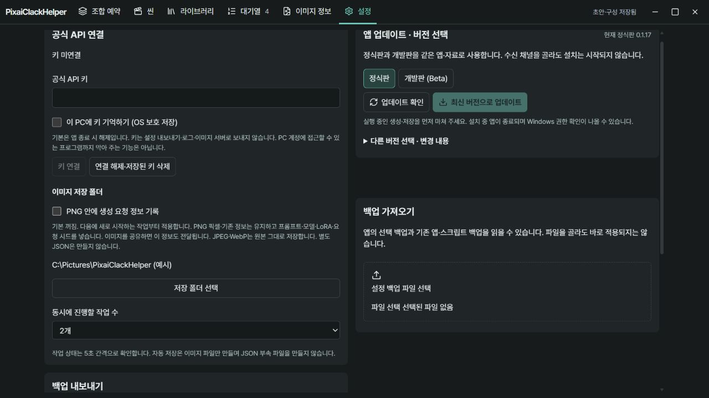
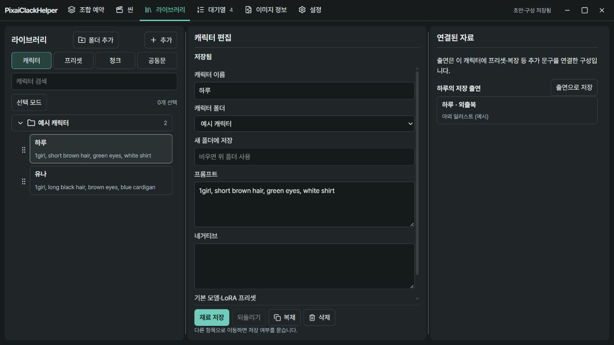
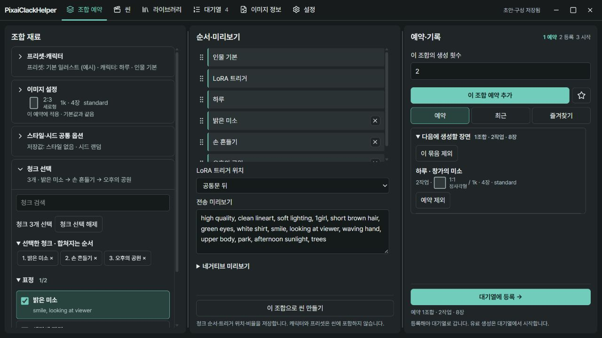
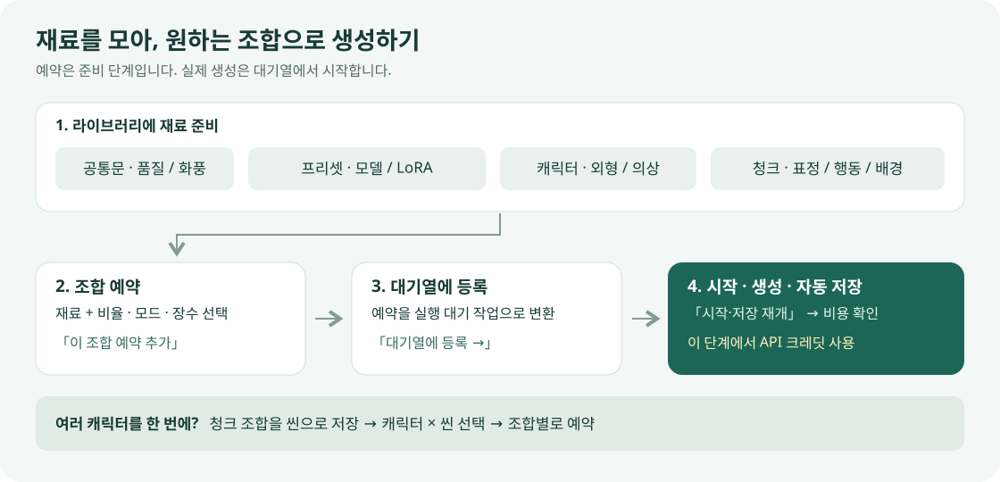
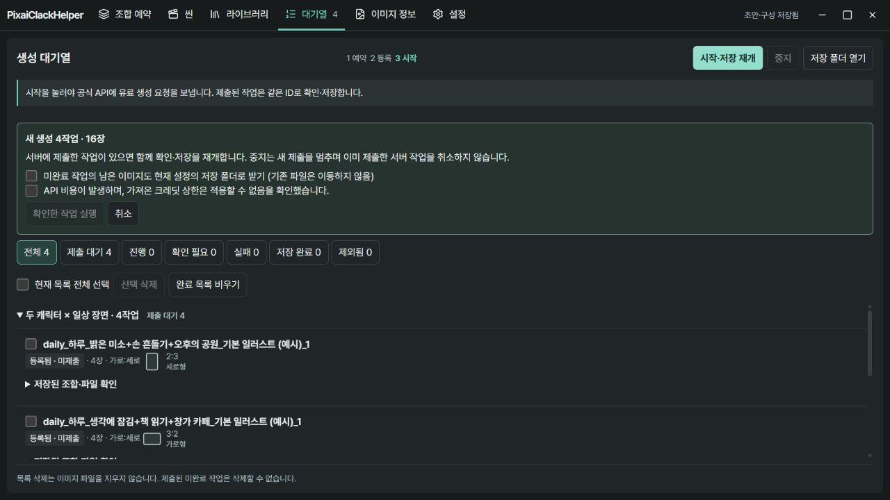
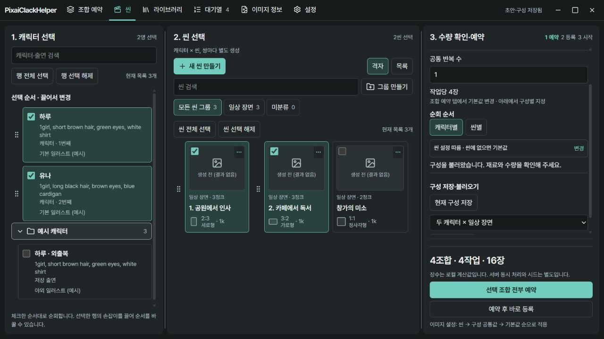
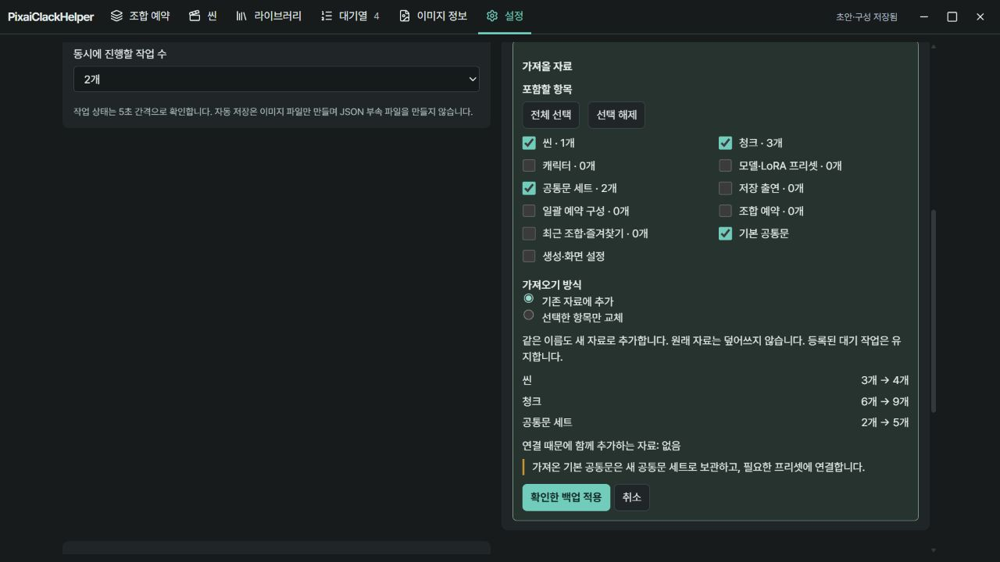
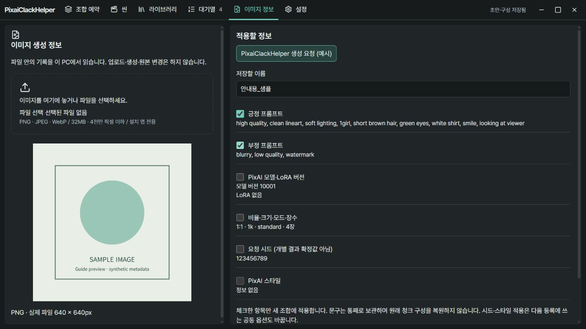

# PixaiClackHelper 그림 사용설명서

**0.1.18 기준 · Windows용**

PixaiClackHelper는 프롬프트 재료를 저장하고, 여러 조합을 예약한 뒤 PixAI 공식 API로 이미지를 생성해 PC에 저장하는 도구입니다. PixAI 계정과 공식 API 키, 생성에 사용할 크레딧이 필요합니다. PixAI와 제휴하지 않은 비공식 앱입니다.

처음이라면 **설치 → 키·저장 폴더 연결 → 재료 만들기 → 한 조합 생성**까지 따라 해 보세요. 이미 재료 백업이 있다면 [백업 가져오기](#7-재료-백업과-가져오기)로 재료 준비를 대신할 수 있습니다.

> 아래 캡처는 0.1.17의 앱 화면을 예시 자료로 띄운 브라우저 미리보기입니다. 0.1.18에서는 폴더 선택·백업·대기열 배치가 일부 달라졌으며, 사용 방법은 아래 설명을 기준으로 보세요. 개인 자료와 실제 유료 생성 결과를 사용하지 않았습니다. API 연결·생성·파일 읽기·업데이트는 Windows 설치 앱에서 사용합니다.

## 1. 설치하고 API 키 준비하기

1. [최신 정식 출시](https://github.com/cotton100/PixaiClackHelper/releases/latest)를 엽니다.
2. 출시 페이지의 **Assets**에서 `PixaiClackHelper-<version>-setup.exe`를 받아 실행합니다.
3. 설치를 마치고 PixaiClackHelper를 엽니다. 기존 사용자는 사용하던 설치 위치에 업데이트합니다.
4. [PixAI 공식 API 플랫폼](https://platform.pixai.art/)에서 계정의 API 이용 조건을 확인하고 공식 API 키를 준비합니다. 신청·발급 방법과 이용 요금은 플랫폼의 현재 안내를 따르세요.

이 설명서의 생성 기능은 공식 API 키를 사용합니다. 웹사이트 로그인 비밀번호를 앱에 입력할 필요는 없습니다. 앱에는 잔액 조회 기능이 없으므로 크레딧은 PixAI에서 확인해 주세요.

기존 앱에서 업데이트가 가능하면 [앱 안에서 업데이트하기](#9-정식판개발판-업데이트)를 이용하세요. 오래된 PixAIS에서 출시 목록을 읽지 못하면 최신 정식 설치 파일로 업데이트할 수 있습니다.

## 2. 키와 이미지 저장 폴더 연결하기

*설정 화면: API 키를 연결하고, 생성한 이미지를 받을 폴더를 지정합니다.*

1. 상단 **설정**을 엽니다.
2. **공식 API 연결 → 공식 API 키**에 준비한 키를 붙여 넣습니다.
3. 다음 실행에도 쓰려면 **이 PC에 키 기억하기 (OS 보호 저장)**를 체크합니다. 체크하지 않으면 이번 실행에서만 사용합니다.
4. **키 연결**을 눌러 **키 연결됨** 표시를 확인합니다.
5. 같은 영역의 **이미지 저장 폴더 → 저장 폴더 선택**에서 결과를 받을 폴더를 고릅니다.

‘키 연결됨’은 앱에 키를 연결했다는 뜻입니다. 계정 권한과 실제 생성 가능 여부는 생성 요청에서 확인됩니다. 키를 지울 때는 **연결 해제·저장된 키 삭제**를 누릅니다.

**동시에 진행할 작업 수**는 1~5개입니다. 처음에는 적은 작업으로 생성과 저장을 확인하세요. **PNG 안에 생성 요청 정보 기록**을 켜면 새로 시작하는 작업의 PNG에 프롬프트와 모델 등의 요청 정보가 들어갑니다. 이 PNG를 공유하면 기록된 정보도 함께 전달됩니다. 기본은 꺼짐입니다.

## 3. 재료 네 가지 준비하기

*라이브러리: 왼쪽에서 종류와 항목을 고르고, 가운데에서 편집한 뒤 저장합니다.*

| 재료 | 담는 내용 | 사용하는 곳 |
| --- | --- | --- |
| **공통문** | 여러 조합에 함께 쓸 포지·네거 문구 | 기본 공통문 또는 프리셋에 연결한 공통문 세트 |
| **프리셋** | 모델, LoRA, 트리거와 프리셋 전용 문구 | 어떤 모델·LoRA로 생성할지 선택 |
| **캐릭터** | 인물의 외형 등 계속 유지할 문구 | 조합의 캐릭터 선택 |
| **청크** | 표정·복장·동작·배경처럼 바꿔 끼울 문구 | 여러 개를 골라 순서대로 합치기 |

‘포지’는 넣고 싶은 내용, ‘네거’ 또는 ‘네거티브’는 피하고 싶은 내용을 적는 칸입니다. 처음부터 모든 칸을 채울 필요는 없습니다.

### 공통문

**라이브러리 → 공통문 → 기본 공통문**을 고르고 **공통 포지 / 공통 네거**를 입력한 뒤 **공통문 저장**을 누릅니다. 여러 버전을 쓰려면 **추가**로 이름 있는 공통문 세트를 만드세요.

프리셋의 **연결할 공통문 세트**에서 세트를 선택하면 그 세트가 기본 공통문을 대신합니다. 프리셋 자체의 공통 포지·네거는 그 뒤에 추가됩니다.

### 모델·LoRA 프리셋

1. **라이브러리 → 프리셋 → 추가**를 누르고 프리셋 이름을 적습니다.
2. PixAI에서 사용할 모델의 버전을 선택한 링크를 복사해 **모델 링크**에 넣습니다.
3. **모델 정보 가져오기 → 이 정보 적용**을 누릅니다. 모델 ID와 **모델 버전 ID**를 확인합니다.
4. LoRA를 쓸 때만 **LoRA 추가**를 누릅니다. LoRA의 **링크·ID·버전**을 펼쳐 링크를 읽고 적용한 뒤, 가중치와 **트리거 문구**를 입력합니다.
5. 필요하면 **이 프리셋의 공통 문구**를 채운 뒤 **재료 저장**을 누릅니다.

링크에 버전이 없으면 앱이 버전을 추측하지 않습니다. 사용할 버전을 선택한 링크를 다시 복사하거나 확인한 ID를 직접 입력하세요. 이름을 자동으로 읽지 못하면 직접 적을 수 있습니다. LoRA 트리거 문구는 모델 안내를 보고 직접 입력합니다.

### 캐릭터와 청크

**라이브러리 → 캐릭터 → 추가**에서 이름·프롬프트를 입력하고 **재료 저장**을 누릅니다. 씬 일괄 예약도 쓸 예정이면 **기본 모델·LoRA 프리셋**을 골라 두세요.

**라이브러리 → 청크 → 추가**에서 청크 이름·프롬프트를 입력하고 **재료 저장**을 누릅니다. 표정, 복장, 배경 등을 나누어 저장하면 나중에 필요한 것만 골라 쓸 수 있습니다.

캐릭터와 청크는 **추가** 바로 옆의 **폴더 추가**로 정리할 수 있습니다. 폴더가 접혀 있으면 제목을 눌러 펼치거나 검색하세요. 편집기를 나가기 전에는 **재료 저장**을 눌러 주세요.

**선택 모드**에서 폴더 왼쪽 체크박스를 누르면 안의 항목을 한꺼번에 선택합니다. 검색 중에는 검색에 맞는 항목만 선택하며, 다른 곳에서 이미 선택한 항목은 유지됩니다. 선택한 항목 하나의 손잡이를 다른 폴더 제목에 끌어 놓으면 선택 항목이 함께 이동합니다. 선택하지 않은 항목을 끌면 그 항목만 이동합니다. 드래그 대신 **폴더로 이동**이나 폴더 머리의 **여기로** 버튼도 쓸 수 있습니다.

폴더 제목 옆 아이콘으로 이름을 바꾸거나 폴더를 삭제합니다. **폴더만 삭제**하면 안의 재료는 **미분류**로 옮겨 보존됩니다. **선택 삭제**는 선택한 재료를 지우는 별도 동작입니다.

## 4. 한 조합으로 첫 이미지 만들기

*조합 예약: 왼쪽에서 재료를 고르고 → 가운데에서 실제 합쳐질 문구를 확인하고 → 오른쪽에서 예약합니다.*

1. **조합 예약 → 프리셋·캐릭터**에서 프리셋 하나와 캐릭터 하나를 고릅니다.
2. **이미지 설정**에서 비율·크기와 **1장**을 선택합니다. 비율은 **가로:세로**입니다. 예를 들어 5:3은 가로형입니다. 생성 모드는 **모델 기본값**부터 시작할 수 있습니다.
3. **청크 선택**에서 원하는 청크를 체크합니다. 가운데 **순서·미리보기**에서 손잡이로 청크 순서를 바꾸고, 필요하면 **LoRA 트리거 위치**를 조정합니다.
4. **전송 미리보기**와 **네거티브 미리보기**를 읽습니다. 공통문·캐릭터·청크가 의도대로 합쳐졌는지 확인하세요.
5. 오른쪽 **이 조합의 생성 횟수**를 **1**로 두고 **이 조합 예약 추가**를 누릅니다.
6. 예약 목록과 총 작업·장수를 확인한 뒤 **대기열에 등록 →**를 누릅니다. 이 버튼은 예약 목록의 미등록 예약을 모두 등록합니다.
7. 상단 **대기열**로 이동해 [아래 시작 절차](#5-대기열에서-실행하고-결과-보기)를 진행합니다.

비율·크기·장수·모드는 예약마다 보관됩니다. **기본값으로도 저장**을 선택한 뒤 바꾸면 다음 조합의 기본값에도 반영됩니다. 이미 만든 예약은 그대로 유지됩니다.

시드를 고정하거나 스타일을 지정하려면 **스타일·시드 공통 옵션**을 펼치고 **스타일·시드 저장**을 누릅니다. 이 두 값은 **대기열 등록 시** 공통 적용되며, 지원 여부는 모델에 따라 다릅니다. 시드를 비우면 랜덤으로 요청합니다.

### 예약과 대기열은 어떻게 다른가요?

| 단계 | 하는 일 | 유료 생성 요청 |
| --- | --- | --- |
| **예약** | 조합과 반복 수를 목록에 보관 | 아직 보내지 않음 |
| **등록** | 예약을 실제 작업 개수로 풀어 대기열에 넣기 | 아직 보내지 않음 |
| **시작 확인** | 새 작업·장수와 비용 안내를 확인하고 실행 | 여기서 전송 |

**생성 횟수 2 × 4장 배치 = 2작업·8장**입니다. 반복 횟수와 작업당 장수는 서로 다른 설정입니다. 예약한 문구와 등록한 작업은 사본으로 보관하므로 이후 재료를 고쳐도 기존 항목에 소급 반영되지 않습니다.

## 5. 대기열에서 실행하고 결과 보기

*대기열: 새 생성 수량을 확인하고 실행합니다. 각 작업의 진행 상태와 저장 결과를 볼 수 있습니다.*

1. **시작·저장 재개**를 누릅니다.
2. 표시되는 **새 생성 작업 수·장수**를 확인합니다. 이전에 제출한 작업이 남아 있으면 조회·저장도 함께 재개됩니다.
3. API 비용 안내를 읽고 확인란을 체크합니다. 가져온 백업의 크레딧 상한은 적용되지 않습니다.
4. **확인한 작업 실행**을 누릅니다. 이때부터 새 작업에 유료 생성 요청을 보냅니다.
5. 작업이 **저장 완료**가 되면 **저장 폴더 열기**를 누릅니다. 작업 카드의 **저장된 조합·파일 확인**을 펼치면 해당 파일 경로도 볼 수 있습니다.

생성한 원본 이미지 파일을 저장하며, 같은 이름의 다른 파일을 덮어쓰지 않습니다. 4장 배치라면 작업 카드에서 **저장 4/4장**을 확인할 수 있습니다. 별도의 JSON 파일은 만들지 않습니다.

**중지**는 새 작업 제출을 멈춥니다. 이미 PixAI에 제출한 작업은 서버에서 계속 진행될 수 있습니다. 다음에 **시작·저장 재개**를 누르면 기록된 작업 ID로 결과를 이어 받습니다.

### 필요한 작업만 보기

대기열은 기본으로 **최근 7일 + 모든 미완료 작업**을 보여 줍니다. 최근 7일에는 PC의 오늘 날짜가 포함됩니다. 실패 등 확인할 작업은 오래됐어도 날짜 때문에 숨기지 않습니다. 더 오래된 완료 기록은 날짜를 **전체 날짜**로 바꾸면 볼 수 있습니다.

필터를 펼치면 **날짜·캐릭터·씬·프리셋·이미지 비율**을 고를 수 있습니다. 여러 조건은 모두 만족하는 작업만 표시하며, 미완료 작업에도 날짜 외 조건은 적용됩니다. 필터를 접어도 현재 날짜 범위·선택 조건·표시 수가 제목줄에 남습니다. 이전 버전 작업은 등록일 대신 마지막 변경일이 표시될 수 있으며, 날짜가 없는 기록은 숨기지 않습니다.

**필터는 목록을 보는 범위입니다. 시작·저장 재개는 숨겨진 항목을 포함한 전체 대기 작업에 적용됩니다.** 실행 확인에 표시되는 전체 작업 수와 장수를 확인하세요.

**선택 삭제 / 완료 목록 비우기**는 현재 필터에 표시되는 범위에서만 앱 목록을 정리합니다. 숨겨진 기록과 저장된 이미지 파일은 남습니다. 제출한 뒤 아직 저장을 마치지 않은 작업은 삭제할 수 없습니다.

## 6. 여러 캐릭터 × 여러 씬을 한꺼번에 예약하기

*씬: 캐릭터·출연과 장면을 체크하면 각 쌍의 작업 수와 예상 이미지 수를 계산합니다.*

씬은 여러 청크와 그 순서, 추가 문구, 이미지 설정을 묶어 둔 장면입니다. 같은 장면을 여러 캐릭터에 반복해서 적용할 때 편리합니다.

### 씬 만들기

1. **씬 → 새 씬 만들기**를 누르고 이름을 적습니다.
2. **청크** 탭에서 재료를 체크합니다. 또는 **문구·이미지** 탭의 **씬 문구**에 직접 입력합니다.
3. 필요하면 이미지 설정과 **그룹**을 정한 뒤 **씬 저장**을 누릅니다.

조합 예약에서 고른 청크를 재사용하려면 **이 조합으로 씬 만들기**를 누르세요. 씬에는 캐릭터와 프리셋을 넣지 않으므로 다른 캐릭터에도 사용할 수 있습니다.

**새 씬 만들기** 옆의 **그룹 만들기**로 씬을 정리합니다. 그룹의 **체크박스**는 안의 씬을 함께 선택하고, **그룹 이름**은 그 그룹만 보는 필터입니다. 검색 중 그룹 체크는 검색 결과만 선택합니다. 선택한 씬의 손잡이를 다른 그룹이나 **미분류**에 놓으면 선택한 씬이 함께 이동합니다. 씬 사이에 놓으면 생성 순서를 바꿉니다. 그룹 이름으로 필터를 고르면 이름 변경·삭제 도구가 나타나며, 그룹을 삭제해도 안의 씬은 미분류에 보존됩니다.

### 일괄 예약하기

1. 캐릭터의 **기본 모델·LoRA 프리셋**이 지정되어 있는지 확인합니다. 같은 캐릭터의 복장·추가 문구·프리셋을 따로 묶으려면 라이브러리의 **출연으로 저장 → 출연 저장**을 사용합니다.
2. **씬** 왼쪽에서 캐릭터·출연을, 가운데에서 씬을 여러 개 체크합니다.
3. 오른쪽에서 **공통 반복 수**, **순회 순서**의 **캐릭터별 / 씬별**, **구성 공통 이미지 설정**을 정합니다.
4. 아래의 **조합·작업·장수**를 확인하고 **선택 조합 전부 예약**을 누릅니다.
5. **조합 예약 → 대기열에 등록 →**를 누른 뒤 대기열에서 실행합니다. **예약 후 바로 등록**을 쓰면 이번 구성만 바로 대기열로 보낼 수도 있습니다.

예를 들어 **캐릭터 3개 × 씬 3개 × 반복 2회 = 9조합·18작업**입니다. 모두 4장 배치라면 총 72장을 요청합니다. 각 캐릭터와 씬의 쌍을 별도로 생성하는 기능입니다.

묶음 이름 줄을 펼치면 조합별 반복 수를 바꿀 수 있습니다. **빈칸은 공통 반복 수, 0은 해당 조합 제외**입니다. 자주 쓰는 선택은 **현재 구성 저장**으로 보관합니다.

씬에 지정한 이미지 설정이 가장 먼저 적용되고, 없는 값은 구성 공통값, 그다음 기본값을 따릅니다. 씬 편집에서 청크 문구를 고치면 그 씬의 사본만 바뀝니다. 라이브러리 원본 수정분을 가져오려면 씬의 **최신 청크로 갱신**에서 차이를 확인하세요.

이 버전에서 씬을 통해 새로 생성·저장한 결과는 해당 씬 카드의 작은 미리보기에 표시됩니다. 이전 작업의 결과를 소급해서 연결하지는 않습니다.

## 7. 재료 백업과 가져오기

*백업: 어떤 종류를 가져올지, 기존 자료에 추가할지 교체할지 고른 뒤 적용 결과를 확인합니다.*

### 백업 저장

1. **설정 → 백업 내보내기**에서 보관할 종류를 체크합니다.
2. **청크·씬**은 종류 아래 폴더 목록을 펼쳐 **전체 폴더** 또는 필요한 폴더만 고릅니다. 폴더가 없는 항목은 **미분류**로 선택합니다. 빈 폴더도 보관할 수 있습니다. 캐릭터 등 나머지 종류는 종류 전체를 선택합니다.
3. **앱용 내보내기**를 누르고 포함 항목을 확인합니다.
4. **백업 파일 저장**을 누릅니다.

폴더 목록을 접어도 선택한 폴더 이름과 항목 수가 남고, 위의 **선택** 요약에서도 범위를 확인할 수 있습니다. 개별 카드 단위 백업 선택은 지원하지 않습니다.

씬이 사용하는 청크 등 필요한 연결 자료와 폴더는 함께 포함됩니다. 직접 고른 범위와 자동 포함된 연결 자료를 미리보기에서 확인하세요. API 키·이미지 저장 폴더·이미지 파일·이미 등록한 대기 작업은 들어가지 않습니다. 이미지도 보관하려면 저장 폴더를 별도로 백업하세요.

이 재료 백업과 업데이트 전에 앱이 만드는 **전체 DB 백업**은 다릅니다. 전체 DB 백업에는 OS로 보호한 키 정보가 포함될 수 있으므로 다른 사람에게 보내지 마세요. 재료 백업을 공유할 때도 프롬프트 내용을 확인하세요.

### 백업 불러오기

1. **설정 → 백업 가져오기 → 설정 백업 파일 선택**에서 JSON 파일을 고릅니다.
2. 가져올 종류와 폴더를 체크하고 아래 방식 중 하나를 고릅니다. 폴더 선택 백업에서는 파일에 담긴 범위 안에서만 고를 수 있습니다.
3. 적용 전후 자료 개수·함께 들어오는 연결 자료와 **최종 적용** 범위를 확인합니다.
4. **확인한 백업 적용**을 누릅니다.

| 가져오기 방식 | 적용 결과 |
| --- | --- |
| **기존 자료에 추가** | 원래 자료를 유지하고 새로 추가합니다. 같은 이름도 별도 자료가 됩니다. |
| **선택한 항목만 교체** | 청크·씬에서 **전체 폴더**이면 해당 종류 전체를, **일부 폴더**이면 그 폴더와 안의 항목만 교체합니다. **미분류**만 고르면 미분류 항목만 교체합니다. 나머지는 체크한 종류 전체를 교체합니다. 선택하지 않은 폴더와 종류는 유지됩니다. |

교체는 백업에 저장된 폴더 식별자를 기준으로 합니다. **이름만 같은 별개의 폴더를 자동으로 합치지는 않습니다.** 빈 폴더로 교체하면 대상 폴더의 내용이 비워지고, 전체 종류를 0개인 백업으로 교체하면 그 종류의 목록이 비워집니다. 적용 전 미리보기에서 범위를 확인하세요.

자동으로 따라온 연결 자료는 기존 자료에 **추가**하며, 그 종류 전체를 교체하지 않습니다. 남겨 둔 예약의 문구와 기존 씬의 청크 사본도 유지됩니다. 바뀐 청크를 기존 씬에 반영하려면 씬에서 **최신 청크로 갱신**을 사용하세요.

처음 가져올 때는 기본 선택인 **기존 자료에 추가**를 사용하면 됩니다. **생성·화면 설정**을 따로 체크하면 추가/교체 방식과 관계없이 파일의 설정으로 바뀝니다. API 키와 이미지 저장 폴더, 등록된 대기 작업은 유지합니다.

기존 앱·유저스크립트 백업도 가져와 폴더로 범위를 좁힐 수 있습니다. **폴더 선택 백업은 0.1.18 이상 앱에서 읽으세요.** 이전 앱에서는 이 형식을 거부합니다. **스크립트용 내보내기**에는 앱 전용 씬·출연 등 일부 정보가 빠지므로, 표시되는 제외 항목을 확인하세요. 위 종류·폴더 선택은 앱용 내보내기에만 적용됩니다.

## 8. 이미지에서 생성 정보 읽기

*이미지 정보: 파일에 남은 기록을 확인하고 필요한 문구·설정을 새 재료나 조합으로 가져옵니다.*

1. 상단 **이미지 정보**를 엽니다.
2. PNG·JPEG·WebP 한 장을 놓거나 파일을 선택합니다. 32MB·4천만 픽셀 이하의 정지 이미지를 지원합니다.
3. 기록의 출처를 고르고 적용할 항목을 체크합니다. 정보가 없는 칸은 선택할 수 없습니다.
4. **선택 정보로 조합 열기 → 확인하고 새 조합 열기**를 누릅니다.

이미지를 PC 안에서 읽으며 업로드나 크레딧 사용은 없습니다. 파일에 기록이 없으면 프롬프트를 알아낼 수 없습니다. 이름만 있는 모델을 정확한 모델 ID로 추측하지도 않습니다.

문구만 재사용하려면 **이 출처 문구를 청크로 저장**, 모델 정보만 보관하려면 **이 출처 모델을 프리셋으로 저장**을 누르세요. 가져온 문구는 통째로 보관하며 원래의 청크 구성을 복원하지 않습니다.

새 조합을 열어도 기존 재료·예약·등록 작업은 유지합니다. 다만 **시드·스타일을 적용하면 다음 대기열 등록에 쓰는 공통 옵션도 변경**됩니다. 새 조합의 전송 미리보기를 확인한 뒤 예약하세요.

## 9. 정식판·개발판 업데이트

1. 진행 중인 생성과 저장을 마칩니다.
2. **설정 → 앱 업데이트 · 버전 선택**을 엽니다.
3. 일반 사용은 **정식판**, 새 기능을 먼저 시험하려면 **개발판 (Beta)**을 고릅니다.
4. **업데이트 확인** 후 **최신 버전으로 업데이트**를 누릅니다. 다른 채널을 골랐다면 대상 버전이 적힌 **전환** 버튼을 사용합니다.

정식판과 개발판은 **같은 앱·설치 위치·자료**를 이어서 씁니다. 채널을 고르는 것만으로 설치하지 않습니다. 업데이트 버튼을 누르면 자료 호환 확인·다운로드·검증·백업 후 설치하고 앱을 다시 엽니다. Windows 권한 확인이 나타날 수 있습니다.

**다른 버전 선택 · 변경 내용**에서 상세 내용을 보거나 다른 버전을 고를 수 있습니다. 현재 자료를 읽지 못하는 구버전은 설치할 수 없습니다. 미완료 생성·저장이나 제출 결과 미확정 작업이 있으면 먼저 처리해 주세요.

이전에 별도로 설치한 Beta의 자료는 자동으로 합치지 않습니다. 필요한 재료는 기존 Beta에서 앱용 백업을 내보내 정식 앱으로 가져오세요.

## 10. 멈췄거나 안내가 나타났을 때

| 화면의 상태·안내 | 할 일 |
| --- | --- |
| **등록됨 · 미제출 / 제출 대기** | 등록만 마친 상태입니다. 키·저장 폴더를 확인하고 **시작·저장 재개**를 누릅니다. |
| **서버 생성 중** | PixAI의 결과를 기다리는 중입니다. 같은 조합을 다시 등록할 필요는 없습니다. |
| **작업 조회 재개 필요** | 연결 상태와 작업의 오류 문구를 확인한 뒤 **시작·저장 재개**로 기존 작업 조회를 이어 갑니다. |
| **저장 재개 필요** | 저장 폴더와 디스크 여유 공간을 확인합니다. 다시 생성하지 않고 남은 이미지 저장을 재개합니다. |
| **제출 결과 확인 필요** | 서버 제출 여부를 확정하지 못했습니다. PixAI에서 결과를 확인하세요. 앱은 자동 재제출과 다른 새 생성을 보류합니다. |
| **실패 · 자동 재생성 안 함** | 작업 카드의 오류 번호·문구를 확인합니다. 키·모델 버전·생성 옵션 등 원인을 고친 뒤 다시 생성하려면 새로 예약해야 합니다. |
| **공식 API 오류** | 오류 번호와 함께 키·모델 버전·선택 옵션을 확인하세요. 번호만으로 원인을 단정하지 말고 PixAI 계정의 API 이용 상태도 확인합니다. |
| **연결이 끊긴 재료 / 프리셋 연결 끊김** | 라이브러리에서 빠진 재료나 기본 프리셋 연결을 확인합니다. 앱이 임의의 다른 재료로 바꾸지는 않습니다. |

저장 위치를 바꿔야 한다면 **설정 → 저장 폴더 선택**으로 새 폴더를 고릅니다. 시작 확인에서 **미완료 작업의 남은 이미지도 현재 설정의 저장 폴더로 받기**를 체크하면 남은 이미지만 새 위치로 받습니다. 이미 저장한 파일은 이동하지 않습니다.

**제출 결과 확인 필요**에서 PixAI의 결과를 확인한 뒤 다른 작업을 계속하려면 해당 카드의 **이 작업 보류 종료… → 확인했습니다 · 재제출 없이 보류 종료**를 사용합니다. 이 조작은 기록을 남기고 보류를 풀며, 서버 작업을 취소하거나 같은 작업을 다시 제출하지 않습니다.

### “저장된 자료가 다른 곳에서 변경되어 덮어쓰기를 막았습니다”

현재 화면으로 더 최신 자료를 덮어쓰지 않도록 편집·새 생성을 잠시 막은 상태입니다.

1. 편집 중인 필요한 문구를 먼저 복사해 둡니다.
2. 필요하면 **화면에 남은 재료 백업**으로 설정의 내보내기를 엽니다. 이 백업에는 조합 초안·등록 작업·편집 중인 입력은 포함되지 않습니다.
3. **최신 자료 다시 불러오기 → 미저장 변경을 버리고 불러오기**를 누릅니다.

문제가 계속되면 앱 버전, 눌렀던 버튼, 오류 문구와 상태를 함께 확인해 주세요. API 키가 보이는 화면은 공유하지 마세요.

---

[상세 기능·개발 안내](PIXAIS.md) · [출시 목록](https://github.com/cotton100/PixaiClackHelper/releases) · [PixAI 공식 이미지 생성 문서](https://platform.pixai.art/en/docs/api-v2/image/createImage) · [공식 요청 제한 안내](https://platform.pixai.art/en/docs/quick-start/limits)
